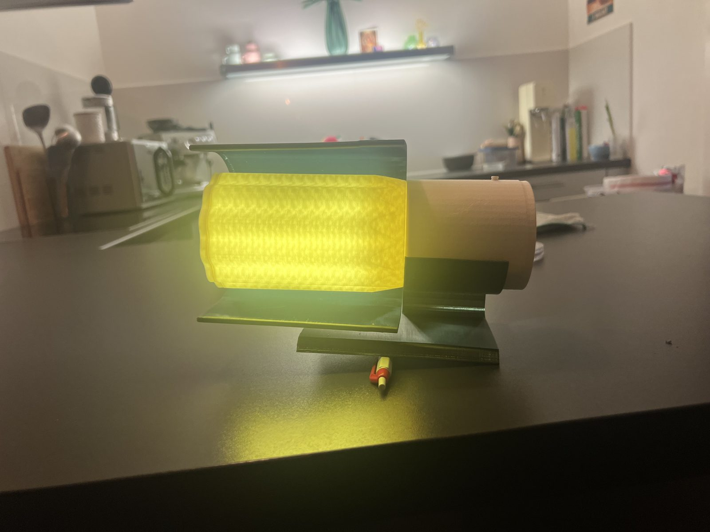
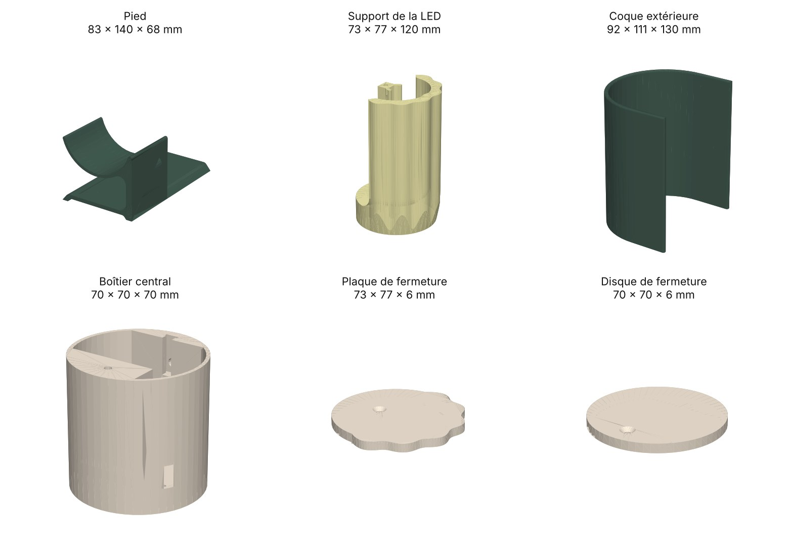

# Lampe de chevet inspirée du Braun HL70

Une lampe de chevet qui reprend la silhouette du ventilateur Braun HL70, modélisée sous Inventor, imprimée en 3D et construite autour de l'**électronique complète d'une lampe frontale du commerce**, réemployée telle quelle.

Projet personnel — décembre 2025.



---

## Le principe

Plutôt que de concevoir une électronique, j'ai démonté une lampe frontale rechargeable (200 lumens, éclairage à 270°) pour en récupérer **tout** : bande LED, batterie, carte de charge et bouton. La lampe a ensuite été dessinée autour de ces composants, sans les modifier.

Les dimensions de la carte, de la batterie et de la bande LED imposaient donc la géométrie intérieure. Un support maintient la carte, une petite pièce prolonge le bouton d'origine jusqu'à l'extérieur, et le port de charge reste accessible : la lampe se recharge comme la frontale d'origine.

## Les pièces



| Pièce | Fichier | Rôle | Dimensions (mm) |
|---|---|---|---|
| Pied | `socle` | Support de la lampe posée à l'horizontale | 140 × 83 × 68 |
| Support de la LED | `socle_lumiere` | Porte la bande LED | 120 × 77 × 73 |
| Coque extérieure | `couvercle` | Enveloppe courbe | 130 × 111 × 92 |
| Boîtier central | `corps` | Loge la batterie et la carte | 70 × 70 × 70 |
| Plaque de fermeture | `fermeture7` | Ferme une extrémité | 77 × 73 × 6 |
| Disque de fermeture | `COUVERCLE2` | Ferme l'autre extrémité | Ø 70 × 6 |
| Support de carte | `reposecarte` | Maintient la carte électronique | — |
| Bouton | `bouton` | Prolonge le bouton d'origine | 4,6 × 4 × 4,6 |

L'assemblage complet est `cao/EG_Lampe.iam`. Le fichier `socle2.ipt` est un premier essai de pied, conservé pour l'historique.

## Impression

- Imprimante **Bambu Lab P1S** avec le module multicouleur **AMS**
- **PLA** pour les pièces de structure et de couleur
- **PETG transparent** pour laisser passer la lumière
- Fichiers prêts à imprimer (Bambu Studio) : dossier `impression/`

## Contenu du dépôt

```
cao/         Pièces (.ipt) et assemblage (.iam) Inventor
stl/         Pièces exportées en STL
impression/  Projets Bambu Studio (.3mf)
media/       Photos, vidéo et rendus
```

L'historique Git retrace les étapes de la conception, du premier essai de pied (26 novembre 2025) à l'assemblage final (19 décembre 2025).

## Licence

**CC BY-NC-ND 4.0** : partage autorisé en citant l'auteur, sans utilisation commerciale ni modification. Voir [`LICENSE.md`](LICENSE.md).

La forme s'inspire du ventilateur Braun HL70 ; ce projet personnel n'est ni affilié à Braun ni approuvé par Braun.

---

Portfolio de Mattéo Pozzo di Borgo : [p0770.github.io](https://p0770.github.io/projects/lampe-braun)
